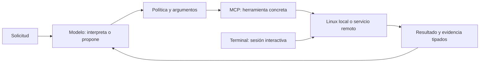

# Análisis funcional: MCP, modelos y terminal

Fecha: 24 de octubre de 2026. Revisión de código actual, metadatos públicos y captura de terminal ya existente. Esta revisión no modifica la aplicación, no ejecuta herramientas MCP ni comandos en el teléfono y no incluye tests ni inferencias. La captura disponible es anterior a la última instalación: no acredita el aspecto visual actual.

## Conclusión

La implementación contiene conexiones y ejecutores reales, pero no hay evidencia para declarar que todo es funcional de extremo a extremo. Existen fallos nuevos al cruzar política, parser, argumentos, resultados y supervisión de procesos. Deben corregirse antes de presentar la combinación como un agente universal terminado.

## Qué existe de verdad

| Pieza | Implementación observada | Límite real |
|---|---|---|
| MCP remoto | Inicialización JSON-RPC, sesión, catálogo paginado, tools/call, JSON/SSE, Bearer, persistencia segura y cierre de clientes | Conexiones externas Streamable HTTP; no es un cliente universal de todos los transportes/autenticaciones |
| Device Inspector | 11 definiciones locales: observar, buscar, pulsar, escribir, navegar, abrir aplicaciones y consultar métricas/catálogo | Varias acciones dependen del servicio de accesibilidad; conexión al adaptador no concede permisos Android |
| Nano Mobile | 8 herramientas: observe, tap, type, swipe, press_key, launch_app, verify y get_ledger_history | La conexión comprueba el servicio y puede quedar degradada si no hay snapshot útil |
| Nano Linux MCP | 6 herramientas publicadas: listar, leer y escribir archivos; crear tar; git status y listar procesos | El ejecutor interno tiene más operaciones que las expuestas por este catálogo |
| Terminal | PTY POSIX interactivo y ejecución no interactiva de procesos mediante ShellExecutor/Nanoshell | Depende de binarios instalados, ABI, permisos y recursos; no concede root Android |
| Modelos | Router de texto hacia llama.cpp, LiteRT-LM y MNN; selección por metadatos | Que exista la ruta no acredita soporte de cada arquitectura, carga, RAM, velocidad o calidad |
| Imágenes del chat | OCR y etiquetas locales mediante Android/ML Kit | Esta ruta no entrega la imagen directamente a los VLM del catálogo |
| Voz | Adaptador Whisper GGML para Tiny/Base | Los otros ASR, TTS y diarización catalogados necesitan su adaptador específico |

El registro local y los conectores del agente son adaptadores dentro de Nano. Nano actúa como cliente de servidores MCP remotos. No se encontró que su existencia publique automáticamente un servidor MCP de Nano para clientes externos.

## Verificación pública del catálogo

Se inspeccionaron las 33 entradas contra la API pública de Hugging Face, sin descargar pesos:

- Las 33 entradas tienen metadatos de repositorio accesibles, agrupadas en 30 consultas de repositorio/revisión.
- Los 32 archivos individuales existen en la revisión indicada y su SHA-256 publicado coincide con el catálogo.
- Qwen2.5-Omni MNN es un paquete de varios archivos. Se confirmó el repositorio, pero esta comprobación no validó cada archivo del paquete ni su manifiesto.
- Clasificación declarada: 21 LLM, 5 STT, 3 embeddings, 1 VLM, 1 OCR, 1 diarización y 1 TTS.

Estos datos prueban identidad publicada, no ejecución. El estado de instalados, selección activa e inferencia en el teléfono no se consultó en esta revisión. La memoria publicada/estimada y el peso del archivo son medidas distintas.

Evidencia reproducible: [catalog-metadata.json](catalog-metadata.json). Las fichas de Nano ya distinguen modalidad publicada de integración local, aunque runtimeReady sigue siendo una comprobación de tipo/backend y no una sonda de inferencia.

## Hallazgos nuevos

### F01 · P1 · Política semántica incompleta para MCP

Las cuatro categorías mcp están en ToolRegistry pero no en kAutomationSemanticPolicies. ToolDefinition degrada su riesgo a observation y PolicyEngine.requiresConfirmation devuelve false si no encuentra definición, antes de consultar la política inyectada.

Ubicación: [tool_registry.dart](C:/Users/emman/Desktop/Proyectos/Nueva carpeta/Nanoai/products/nanoMOBILE/flutter_app/lib/features/automation/engine/execution/tool_registry.dart:594). Recomendación: Definir contratos canónicos de lectura, dispositivo, escritura y privilegios; denegar identidades sin contrato. Revisar confirmación y journal juntos antes de ampliar acciones.

### F02 · P1 · Las anotaciones de cualquier servidor deciden si una herramienta es lectura

McpToolProjection clasifica como read por readOnlyHint y destructiveHint sin consultar confianza del servidor ni una política local por herramienta. Un servidor externo puede declarar mal su efecto.

Ubicación: [mcp_tool_projection.dart](C:/Users/emman/Desktop/Proyectos/Nueva carpeta/Nanoai/products/nanoMOBILE/flutter_app/lib/features/automation/engine/mcp/mcp_tool_projection.dart:17). Recomendación: Añadir confianza explícita y clasificación local; una declaración remota no debe rebajar permisos por sí sola.

### F03 · P2 · El parser rompe la identidad mcp.externalWrite

AgentToolProtocol pasa nombres a minúsculas y solo restaura dos alias Linux. El registro y el dispatcher esperan mcp.externalWrite con W mayúscula. Una llamada del LLM puede ser rechazada como desconocida.

Ubicación: [agent_tool_protocol.dart](C:/Users/emman/Desktop/Proyectos/Nueva carpeta/Nanoai/products/nanoMOBILE/flutter_app/lib/features/automation/engine/execution/agent_tool_protocol.dart:144). Recomendación: Normalizar contra identidades canónicas del registro, conservando nombres remotos sensibles a mayúsculas. Corregir F01 antes de habilitar más escrituras.

### F04 · P2 · Selección natural y argumentos MCP incompletos

El proveedor busca coincidencia literal con tool.name o tool.id y adapta con {}. No deriva argumentos del inputSchema. El ejecutor revalida la categoría, pero no valida el JSON Schema remoto antes de llamar.

Ubicación: [mcp_candidate_provider.dart](C:/Users/emman/Desktop/Proyectos/Nueva carpeta/Nanoai/products/nanoMOBILE/flutter_app/lib/features/automation/engine/mcp/mcp_candidate_provider.dart:39). Recomendación: Resolver intención contra descripciones reales, mostrar/proveer esquema de la herramienta elegida, validar argumentos y preguntar por los obligatorios que falten.

### F05 · P2 · Escritura de archivos altera el texto recibido

SemanticLinuxToolHandler utiliza _extractString para content; ese helper aplica trim(). Puede eliminar espacios y saltos que forman parte de código o documentos. El escritor usa un heredoc y la verificación comprueba presencia/tamaño, no igualdad del contenido.

Ubicación: [semantic_linux_tool_handler.dart](C:/Users/emman/Desktop/Proyectos/Nueva carpeta/Nanoai/products/nanoMOBILE/flutter_app/lib/features/automation/engine/execution/handlers/semantic_linux_tool_handler.dart:54). Recomendación: Separar lectura de identificadores y lectura literal de contenido; verificar bytes o hash cuando la operación promete escritura exacta.

### F06 · P2 · El supervisor declara inicio verificado antes de confirmar el proceso

startProcess lanza un Future sin esperarlo y devuelve exitCode 0 y process_started inmediatamente. Si falla el arranque, solo llega un log posterior. stopProcess confirma envío de señal, no salida del proceso.

Ubicación: [linux_process_supervisor.dart](C:/Users/emman/Desktop/Proyectos/Nueva carpeta/Nanoai/products/nanoMOBILE/flutter_app/lib/features/automation/executors/linux/linux_process_supervisor.dart:93). Recomendación: Distinguir solicitado, lanzado con PID, ejecutándose y terminado; no usar satisfied para una operación aún no observada.

### F07 · P2 · Resultados tipados se convierten en texto y se reclasifican por prefijo

El manejador MCP convierte McpToolCallResult en String. PlanExecutionCoordinator considera fallo cualquier prefijo alfabético entre corchetes; una respuesta válida que empiece por [INFO] puede interpretarse como error.

Ubicación: [plan_execution_coordinator.dart](C:/Users/emman/Desktop/Proyectos/Nueva carpeta/Nanoai/products/nanoMOBILE/flutter_app/lib/features/automation/engine/execution/plan_execution_coordinator.dart:98). Recomendación: Mantener estado, contenido y evidencia tipados hasta journal/interfaz. El texto mostrado no debe determinar el resultado de ejecución.

### F08 · P2 · Resultados de imagen/audio MCP no se conectan a una modalidad del modelo

El parser conserva texto/URI/MIME pero no representa binarios de forma utilizable en McpContentItem. Guarda el resultado completo como structuredContent; si no hay texto, el manejador puede serializarlo a JSON, incluido base64, para un consumidor textual.

Ubicación: [http_mcp_parser.dart](C:/Users/emman/Desktop/Proyectos/Nueva carpeta/Nanoai/products/nanoMOBILE/flutter_app/lib/features/automation/engine/mcp/http_mcp_parser.dart:98). Recomendación: Resolver y limitar adjuntos tipados; enrutarlos al adaptador compatible u ofrecer apertura/descarga. No enviar base64 como supuesto entendimiento visual.

### F09 · P2 · El detalle de un nodo puede superar la altura de pantalla

La hoja de detalle usa Column de tamaño mínimo y muestra todo el JSON de metadatos/esquema sin un contenedor desplazable ni altura máxima. Un esquema largo puede desbordar, especialmente en horizontal.

Ubicación: [mcp_graph_node_details.dart](C:/Users/emman/Desktop/Proyectos/Nueva carpeta/Nanoai/products/nanoMOBILE/flutter_app/lib/features/automation/presentation/widgets/mcp/mcp_graph_node_details.dart:22). Recomendación: Acotar altura por viewport y poner contenido desplazable, conservando acciones accesibles y colores del tema.

### F10 · P2 · El parser de llamadas cuenta llaves dentro de cadenas

El balanceo de objetos/arrays cuenta caracteres sin distinguir cadenas JSON ni escapes. Una cadena que contenga una llave no balanceada puede truncar una llamada válida; el fallback tolerante no conserva todos los argumentos anidados.

Ubicación: [agent_tool_protocol.dart](C:/Users/emman/Desktop/Proyectos/Nueva carpeta/Nanoai/products/nanoMOBILE/flutter_app/lib/features/automation/engine/execution/agent_tool_protocol.dart:144). Recomendación: Usar un extractor JSON consciente de cadenas y escapes y rechazar argumentos incompletos sin fabricarlos.

## Brechas funcionales que no deben anunciarse como terminadas

- El conector remoto no implementa el flujo OAuth completo: solo hay un campo Bearer manual. La entrada WhatsApp Business Tools afirma OAuth/beta/oficial, pero no implica cuenta vinculada ni capacidad de enviar. La documentación de Meta no fue accesible con la herramienta web; su disponibilidad externa y autenticación quedan sin corroborar aquí.
- No se encontró un lanzador genérico de servidores stdio/SSE heredado/WebSocket. El enum incluye esos valores y nano-linux se etiqueta stdio, pero ese cliente llama al manejador Dart interno; no abre por ello un proceso MCP por stdin/stdout.
- El grafo representa una instantánea del registro; conectado no es un heartbeat ni una inferencia comprobada. El journal es una instantánea manual con fecha. Tampoco existe suscripción operativa al cambio de herramientas remotas en esta ruta.
- El catálogo Linux expone seis operaciones; copiar/mover/borrar, extraer tar, git diff/log y gestionar procesos existen en otras capas, pero no aparecen en tools/list de nano-linux. No deben suponerse descubribles desde cualquier cliente MCP.
- El resultado Linux se reduce a muestras: cinco nombres al listar, seis procesos y 500 caracteres al leer. Eso limita análisis de proyectos/documentos completos aunque la lectura interna permita más bytes.
- Seleccionar Gemma/Qwen multimodal no conecta automáticamente visión, vídeo o audio. LiteRT recibe texto en el router actual; MNN mantiene perfil textual; PaddleOCR/embeddings/TTS/diarización no se activan por descargarlos.
- La importación Hugging Face acepta archivos GGUF públicos con checksum. No convierte safetensors a un motor, no resuelve un paquete multimodal entero ni autentica repositorios restringidos mediante esa ruta.
- La biblioteca PDF adjunta del chat no se convierte automáticamente en búsqueda documental MCP/RAG por carpeta, título o contenido. Haría falta una herramienta documental y su integración con permisos e índice.
- La sesión visible de terminal y la ejecución no interactiva del agente son rutas distintas: un comando MCP no hereda automáticamente el cd, variables exportadas o programa interactivo abierto en la pestaña activa.

## Diseño: conservar el estilo y aclarar la jerarquía

El título actual «Modelos y conexiones» mezcla conceptos. El hub contiene API de proveedores IA, conectores MCP, skills y registro; la selección y descarga local vive en otro módulo. Conviene mostrar el modelo asignado como resumen/enlace al selector existente y separar su estado del de un servidor MCP.

Organización propuesta, sin reconstruir la identidad visual:

1. **Conexiones:** tarjetas con servidor, local/remoto, transporte real, estado observado, autenticación y fecha de consulta. El grafo queda como vista alternativa.
2. **Herramientas:** agrupadas por tarea, con descripción breve, argumentos obligatorios, alcance y efecto. «Ver información» y «Ejecutar» deben ser acciones diferentes.
3. **Registro:** ejecución identificable, solicitado/ejecutado/verificado/fallido/incierto y evidencia consultable. Sin etiquetas de tiempo real si no hay suscripción.

Los nodos actuales usan el mismo icono genérico para servidores y el mismo para casi todas las herramientas. Reutilizar la iconografía Nano por función (archivos, visión, terminal, red, mensajería) y reservar logos de proveedor para identidad. Texto principal neutro, acento para selección/acciones y color de estado solo cuando exista evidencia. El grafo necesita la lista accesible y la hoja de detalle debe soportar esquemas largos, teclado y horizontal.

La captura histórica muestra un hub de terminal dominado por portadas y un visor 3D. Se puede conservar ese aspecto, añadiendo acceso compacto a sesión, entorno y disponibilidad efectiva; la portada por sí sola no informa si rootfs, git o un intérprete están instalados. El contraste blanco del título fue corregido en la entrega anterior y necesita comprobación visual posterior.

## Qué podemos hacer con la combinación

| Caso | Viabilidad actual | Qué completar |
|---|---|---|
| Leer archivos y explicar código o logs | Hay lectura Linux y modelos de texto | Evitar recortes silenciosos y confirmar rutas/acceso |
| Crear un reporte local con datos de un MCP remoto | Las dos operaciones existen por separado | Argumentos, encadenamiento, contenido exacto, autorización y comprobación del archivo |
| Procesar JSON/CSV con scripts | Viable desde terminal si está el intérprete | Publicar herramientas estructuradas acotadas; no dar shell libre al modelo |
| Revisar un repositorio Git | git status está publicado; diff/log existen internamente | Comprobar git real y exponer consultas faltantes con resultados completos/paginados |
| Hospedar un servidor MCP local en terminal | Posible arquitectónicamente mediante Streamable HTTP en loopback si están instaladas las dependencias | Arranque confirmado, dueño del proceso, parada, puerto, credenciales y recuperación; no se ha desplegado aquí |
| Analizar fotografías o PDFs y relacionarlos con archivos | El chat tiene OCR y lectura de adjuntos | Herramienta documental MCP y adaptador visual real; no confundirlo con instalar un VLM |

## Orden recomendado de trabajo

Primero F01/F02 (política y confianza). Después F03/F04/F10 (identidades y argumentos). Luego F05/F06/F07/F08 (fidelidad y evidencia). Finalmente F09 y la jerarquía visual. Mantener el catálogo, motores y funcionamiento actual durante cada corrección; no habilitar todas las operaciones de Linux simultáneamente.

Esta revisión solo deja análisis y evidencia. Ningún fallo nuevo fue reproducido mediante acciones sobre el teléfono y no se declara que todos los modelos hayan sido cargados o ejecutados.

## Fuentes primarias contrastadas

- [MCP: tools, esquemas, anotaciones y resultados](https://modelcontextprotocol.io/specification/2025-11-25/server/tools).
- [MCP: límites de confianza de las anotaciones](https://blog.modelcontextprotocol.io/posts/2026-03-16-tool-annotations/).
- [Google AI Edge: ciclo de function calling de LiteRT-LM](https://developers.google.com/edge/litert-lm/cli/usage).
- [Repositorio público Gemma E2B LiteRT](https://huggingface.co/litert-community/gemma-4-E2B-it-litert-lm).

Las reglas del protocolo se contrastaron con fuentes primarias; el estado de Nano se determinó leyendo su código. Fuentes/hashes por ubicación: [references.json](references.json).
